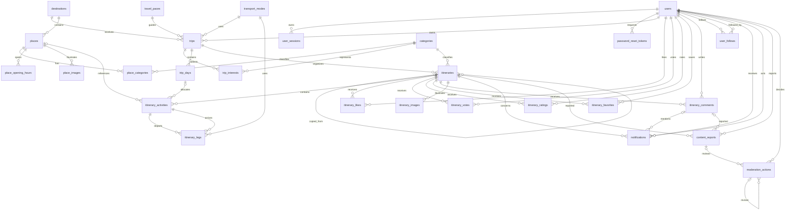

# TripShare database

Modelo PostgreSQL 16 baseado nas convenções e fichas RF-01 a RF-32 do
[documento de requisitos](https://docs.google.com/document/d/1euLvqRRyR7TEQDtwJ5GcOq_YJUydZM2jZKGy_xOtSy8/edit?tab=t.0).
As fichas detalhadas prevalecem sobre as tabelas de resumo divergentes.

Esta entrega implementa a persistência e suas garantias estruturais. Não implementa entidades JPA,
endpoints, autenticação, publicação, geração de roteiros ou fluxos administrativos.

## Executar

Com Docker em execução, entre em `trip.share/`. Opcionalmente copie `.env.example` para `.env` e
ajuste a configuração. Nunca versione credenciais reais.

```bash
# Banco disponível e atualizado, sem executar a aplicação
./scripts/database.sh start

# Verificar histórico e versões pendentes
./scripts/database.sh status

# Reiniciar e verificar migrations novamente
./scripts/database.sh restart

# Aplicar novas versões sem reiniciar PostgreSQL
./scripts/database.sh migrate

# Inserir demonstração explicitamente, somente em desenvolvimento
./scripts/database.sh start --demo

# Aplicação Java local: Compose fornece a conexão; Spring executa Flyway antes do JPA
./mvnw spring-boot:run

# Aplicação completa em containers: PostgreSQL -> migrate -> spring
docker compose --profile app up --build

# Encerrar containers preservando dados
docker compose --profile app down
```

Os comandos do script funcionam a partir de qualquer diretório. `migrate` e `status` pressupõem
que PostgreSQL já esteja disponível. Para `restart`, encerre primeiro a aplicação local para não
executar operações contra um banco em reinicialização. O comando não encerra processos Java externos.

O contrato de atualização automática cobre os comandos do projeto, a execução completa do Compose e
a inicialização do Spring Boot. `docker start`, `docker restart`, o botão do Docker Desktop e
`docker compose up postgres` isoladamente não executam o migrador. Use o script para iniciar só o banco.

### Conexão

| Ambiente | Host | Configuração |
|---|---|---|
| Java local com suporte Compose | Porta publicada em localhost | Descoberta automática pelo Spring |
| Java em container | `postgres:5432` | `SPRING_DATASOURCE_URL/USERNAME/PASSWORD` |
| Migrador em container | `postgres:5432` | `FLYWAY_URL/USER/PASSWORD` |
| Teste de inicialização | H2 em memória | Perfil Spring `test`, Flyway desabilitado |
| Testes de banco | PostgreSQL 16 temporário | Testcontainers, esquemas isolados |

Os padrões `mydatabase` e `postgres/postgres` são exclusivamente de desenvolvimento. Configure
variáveis de ambiente ou `.env`. Alterar essas variáveis não altera usuários/senhas já existentes
em um volume PostgreSQL inicializado: alterações de credenciais existentes exigem operação administrativa.
Não execute o Dockerfile isoladamente esperando que ele forneça banco ou credenciais.
Em produção, use usuários distintos com os privilégios necessários à aplicação e às migrations;
não use a conta administrativa de desenvolvimento nem exponha a porta do banco publicamente.
`SPRING_PORT` permite mudar a porta HTTP publicada. Para executar projetos Compose isolados na mesma
máquina, ajuste também `COMPOSE_PROJECT_NAME`, `POSTGRES_CONTAINER_NAME`, `SPRING_CONTAINER_NAME` e as portas.

## Versionamento e recuperação

Flyway 12.4.0 é gerenciado pelo Spring Boot 4.1.1. O starter e o módulo PostgreSQL habilitam a
integração da aplicação. O estágio Docker `migrate` usa o mesmo projeto Maven e a mesma versão,
sem exigir uma imagem Flyway AMD64 em máquinas ARM64. Os arquivos SQL são montados somente para leitura
nesse serviço, permitindo que `migrate` e `status` enxerguem as versões do checkout atual.
O Maven do migrador opera offline, com dependências previamente resolvidas durante o build.

| Versão | Responsabilidade |
|---|---|
| V1 | Identidade, referências e catálogo |
| V2 | Viagens e planejamento |
| V3 | Comunidade, imagens, notificações e moderação |
| V4 | Integridade entre tabelas, índices, projeções públicas e ranking |
| V5 | Categorias, ritmos e meios de transporte iniciais |
| V6 | Verificação adiável da FK de dias para permitir a cascata completa de exclusão da viagem |

O histórico fica em `flyway_schema_history`. Cada inicialização valida checksums e aplica apenas
versões pendentes, sob o bloqueio de migração do Flyway. A referência de versão mais recente são
os scripts distribuídos com a aplicação/checkout, sem buscar SQL remoto em tempo de execução.

`clean` e baseline automática estão desabilitados. Migrações fora de ordem, scripts com nome
inválido, versões ausentes/mais recentes no banco e checksums diferentes devem interromper a execução.
Hibernate usa `validate`: não cria nem modifica tabelas. Como ainda não existem entidades, essa
validação será ampliada à medida que os mapeamentos forem implementados.

Para evoluir, adicione `V7__description.sql`, depois V8 etc. Nunca edite V1–V6 depois de aplicadas.
Inclua a alteração Java correspondente e testes na mesma história de usuário quando houver entidades.
Uma migration PostgreSQL transacional com erro é revertida; investigue antes de repetir. Não use
`repair` para esconder divergências de scripts. Índices concorrentes futuros exigem migration própria
e tratamento específico de transação e bloqueio, não um `CONCURRENTLY` adicionado arbitrariamente.

Se um banco já contiver tabelas sem histórico Flyway, o processo para com erro. Faça um dump,
compare o esquema e planeje uma baseline explícita ou transformação própria; não apague o volume.
Antes de alterações em dados reais, valide restauração do backup e compatibilidade da aplicação.
`down --volumes` apaga dados e não faz parte do fluxo de atualização.

## Seeds

V5 insere dados de referência reais do domínio: sete categorias, três ritmos e quatro transportes.
Novas opções de referência entram em uma nova migration versionada.

`scripts/seeds/demo.sql` contém fixtures explicitamente fictícias, separadas do JAR e das migrations.
O script só as executa com `--demo` e `APP_ENV=development` (padrão local). O seed usa transação,
bloqueio de concorrência, UUIDs estáveis e `ON CONFLICT DO NOTHING`; repetições não duplicam dados
nem sobrescrevem edições. Se um identificador natural estiver ocupado por um registro incompatível,
o seed falha e reverte, em vez de associar registros a uma conta real.

São criadas as contas `demo_alex`, `demo_sam` e `demo_admin`, com emails no domínio reservado
`example.invalid`; a última tem papel ADMIN. O hash bcrypt corresponde à senha de demonstração
`TripShareDemo2026!`. Isso não implementa login. Nunca use essas contas em produção.
Locais de demonstração têm origem `DEMO` e não representam atrações reais, preços ou coordenadas verificados.
O seed não produz uploads fictícios nem solicita serviços externos.

## Convenções e integridade

- UUIDs nativos nas entidades; códigos naturais nas referências; chaves compostas nos vínculos simples.
- `created_at` e `updated_at` são instantes `timestamptz`; triggers mantêm `updated_at`.
  `version` nas raízes prepara o controle otimista futuro; a aplicação deve incrementá-lo com `@Version`.
- Datas pessoais ficam em `trips`. `trip_days.day_number` começa em 1. Horários são locais ao fuso do destino;
  o identificador de fuso IANA deverá ser validado pela aplicação.
- `duration_days` é calculado como término menos início mais um. Não se armazena uma segunda duração editável.
- Email e username têm índices únicos em `lower(...)`. Consultas de login normalizadas devem usar a mesma
  expressão para aproveitar o índice; telefone não é identificador único.
- `password_hash` aceita hashes codificados; a aplicação deve usar um PasswordEncoder seguro. Nunca persistir
  senha em claro, confirmação de senha, token original ou dados privados em logs.
- Tokens de sessão e recuperação usam representação hexadecimal de SHA-256. Consumo de recuperação deve ser
  atômico, condicionado a `used_at IS NULL` e `expires_at > now()`, seguido da revogação das sessões na mesma transação.
- Durações/valores desconhecidos são `NULL`, nunca zero inventado. Preço conhecido exige moeda e vice-versa.
  Coordenadas são um par completo com limites geográficos. Horários de locais usam dias ISO 1–7 e suportam
  múltiplos períodos e fechamento no dia seguinte; ausência de linhas significa informação desconhecida.
- Atividades conservam nome, observações e localização independentemente do catálogo. Prefira marcar um local
  com `removed_at` ao retirá-lo do catálogo. Exclusão física desfaz a referência e preserva o snapshot da atividade.
- Um dia não pode pertencer a outra viagem nem exceder o período. Antes de encurtar uma viagem, remova/realoque
  atividades e dias fora do novo intervalo, inclusive dias vazios. Atividades sem dia são itens não alocados.
- A ordem pode ser reorganizada em transação com `SET CONSTRAINTS uq_itinerary_activities_position DEFERRED`.
  Mudanças de planejamento descartam trechos derivados afetados; a aplicação deverá recalculá-los.
- Sobreposições e excesso do intervalo disponível geram avisos na futura aplicação: não há proibição absoluta
  no banco porque RF-13 permite salvar após ciência do aviso. Estimativas ausentes permanecem pendentes.
- Um roteiro público exige descrição, categoria, data de publicação e uma atividade com local identificado.
  A constraint de atividades é verificada no fim da transação para permitir salvamento atômico.
- Curtidas, favoritos, votos e notas são vínculos diferentes. Autoria, conta ativa e disponibilidade para
  novas interações devem ser verificadas nos futuros serviços; a unicidade protege contra requisições repetidas.
- `notifications.event_key` identifica a ocorrência, não somente seu tipo. A aplicação deverá gerar a chave
  estável ao repetir uma mesma operação e outra chave para uma nova interação legítima.
- Denúncia aponta exatamente para um roteiro ou comentário. Apenas uma denúncia PENDING por autor/alvo;
  motivo OTHER exige descrição. O registro não aplica automaticamente uma penalidade.
- Moderação registra administrador, justificativa e snapshot histórico. Exclusão do conteúdo pode remover
  a denúncia, mas preserva a decisão, cujo `report_id` vira NULL. A decisão anterior pode ser referenciada por uma revisão.
- Suspensão é vigente até revisão administrativa. Revogar sessões e aplicar/restaurar medidas são operações
  transacionais futuras da aplicação; nenhum email, API externa ou fluxo de negócio é disparado por trigger.

## Exclusão e privacidade

Viagens e roteiros começam privados. Excluir viagem remove seus roteiros, atividades, imagens,
interações, notificações e denúncias. Excluir um roteiro remove seus dependentes. Despublicar apenas
altera a visibilidade e conserva interações e favoritos. Remover arquivos de object storage é tarefa
da aplicação após a transação; uma FK não apaga arquivos externos.

Cópias têm conteúdo independente e não herdam interações. `source_itinerary_id` usa SET NULL quando
o original é excluído; nome do autor e título de origem continuam como atribuição histórica.

As views `public_profiles`, `public_itineraries`, `public_itinerary_activities`,
`public_itinerary_comments` e `public_itinerary_images` não projetam credenciais nem datas privadas.
Elas filtram conteúdo indisponível e autores suspensos. Não são endpoints nem substituem autorização:
credenciais de banco não devem ser entregues aos clientes, e consultas pessoais precisam validar o proprietário.
`itinerary_metrics` é uma view interna, sem autorização por usuário.

## Consultas de referência

Use parâmetros preparados em Java; os valores abaixo são parâmetros psql para exemplos interativos.

```sql
-- Feed geral: primeira página; cursor usa published_at + id das últimas linhas.
SELECT id, title, author_name, destination_name, like_count, vote_count, published_at
FROM public_itineraries
ORDER BY published_at DESC, id DESC
LIMIT 20;

-- Próxima página: o predicado do cursor acompanha exatamente a ordenação.
SELECT id, title, published_at
FROM public_itineraries
WHERE (published_at, id) < (:'cursor_published_at'::timestamptz, :'cursor_id'::uuid)
ORDER BY published_at DESC, id DESC
LIMIT 20;

-- Feed Seguindo, após autenticar e determinar user_id no servidor.
SELECT p.id, p.title, p.author_name, p.published_at
FROM public_itineraries p
JOIN user_follows f ON f.followed_id = p.author_id
WHERE f.follower_id = :'user_id'::uuid
ORDER BY p.published_at DESC, p.id DESC
LIMIT 20;

-- Favoritos preservados: conteúdo privado/moderado aparece indisponível, sem vazamento.
SELECT f.itinerary_id, p.title, (p.id IS NOT NULL) AS available
FROM itinerary_favorites f
LEFT JOIN public_itineraries p ON p.id = f.itinerary_id
WHERE f.user_id = :'user_id'::uuid
ORDER BY f.created_at DESC, f.itinerary_id DESC
LIMIT 20;

-- Ranking: filtros são aplicados ANTES do row_number.
SELECT ranking_position, itinerary_id, title, vote_count, average_rating, rating_count
FROM itinerary_ranking(:'destination_id'::uuid, 'MUSEUM')
ORDER BY ranking_position
LIMIT 20;

-- Sem filtros: average_rating NULL significa Sem avaliações; zero só participa do desempate.
SELECT ranking_position, itinerary_id, vote_count, average_rating, rating_count
FROM itinerary_ranking()
ORDER BY ranking_position
LIMIT 20;
```

O ranking ordena por votos decrescentes, média decrescente, publicação mais antiga e UUID crescente.
Likes e favoritos nunca entram no cálculo. A aplicação define `published_at` na publicação confirmada;
na republicação, usar o instante da nova publicação. Alterações de conteúdo não devem atualizar esse campo.
A busca por interesses usa `EXISTS` com `place_categories` e ao menos um interesse solicitado, evitando
duplicar roteiros com várias categorias. Índices existentes atendem às FKs e filtros principais;
busca textual ampla deve ser medida antes de adicionar extensões/índices especializados.

## Testes

```bash
# Sem Docker: inicialização JPA com H2; não valida SQL PostgreSQL.
./mvnw clean verify

# Docker obrigatório: migrations, constraints, seeds, concorrência, privacidade e ranking.
./mvnw verify -Pdatabase-it
```

Testcontainers inicia PostgreSQL temporário e não utiliza o volume do desenvolvimento. Cada cenário
usa um esquema isolado. O perfil falha quando Docker não está acessível. O build Docker mantém os
testes de inicialização e não tenta iniciar containers dentro do estágio de compilação.

## Diagrama de relacionamentos



## Rastreabilidade de requisitos

| RF | Suporte no banco | Responsabilidade futura da aplicação |
|---|---|---|
| 01 | users, unicidade de email/username | Validar cadastro e confirmação; gerar hash |
| 02 | user_sessions, users.status | Autenticar, validar/revogar sessão |
| 03 | password_reset_tokens, validade e used_at | Enviar link, consumo atômico e revogar sessões |
| 04 | users, public_profiles | Edição pelo proprietário e limites de apresentação |
| 05 | trips, destinations, duração calculada | Resolver destino e listar só viagens próprias |
| 06 | Período e cascatas de trips | Confirmar efeitos e realocar antes de encurtar |
| 07 | trip_interests, trip_days, referências | Exigir interesses e preservar roteiro existente |
| 08 | places, destination_id, place_categories | Busca paginada e fontes externas |
| 09 | Origem, campos opcionais e snapshots | Indicar dados ausentes e locais removidos |
| 10 | Catálogo, categorias e preferências | Seleção e explicação das recomendações |
| 11 | Itinerários AUTOMATIC, dias, atividades, trechos | Geração, horários, pendências e confirmação |
| 12 | Itinerários MANUAL privados | Cadastro manual vinculado à viagem própria |
| 13 | Atividades, ordem, limites de dias e cascatas | Salvar atomicamente e confirmar avisos |
| 14 | Coordenadas e posição das atividades | Renderização e fallback do mapa |
| 15 | itinerary_legs, status e estimativas opcionais | Consultar provedor e recalcular |
| 16 | Visibilidade, campos e atividade obrigatória | Confirmar publicação/despublicação |
| 17 | Projeções públicas e métricas | Consulta pública sem dados pessoais |
| 18 | Categoria, destino, duração e índices | Combinar filtros e interesses com EXISTS |
| 19 | Publicação e user_follows | Feed paginado e cursor |
| 20 | itinerary_likes, PK composta | Validar autor/visibilidade e notificar |
| 21 | itinerary_comments, limite e edited_at | Autorizar edição/exclusão |
| 22 | itinerary_ratings, nota e PK composta | Validar autor e apresentar média NULL |
| 23 | itinerary_votes, PK composta | Voto positivo de outro autor e retirada |
| 24 | itinerary_metrics, itinerary_ranking | Paginação/apresentação do ranking filtrado |
| 25 | itinerary_favorites | Lista privada e itens indisponíveis |
| 26 | itinerary_images, MIME/tamanho/posição | Validar arquivo real e gerenciar storage |
| 27 | user_follows, unicidade e autores distintos | Disponibilidade do perfil e autorização |
| 28 | Trips, origem e visibilidade dos itinerários | Histórico próprio e filtros |
| 29 | Origem COPIED, referência e atribuição | Copiar conteúdo em transação sem interações |
| 30 | notifications, event_key e read_at | Criar evento na transação, sem duplicar |
| 31 | content_reports, motivo e pendência única | Validar acesso e aceitar denúncia |
| 32 | moderation_actions, flags e users.status | Verificar ADMIN, aplicar medida e revogar sessões |

O dicionário completo de colunas, tipos, valores padrão e constraints está em [database-dictionary.md](database-dictionary.md).
