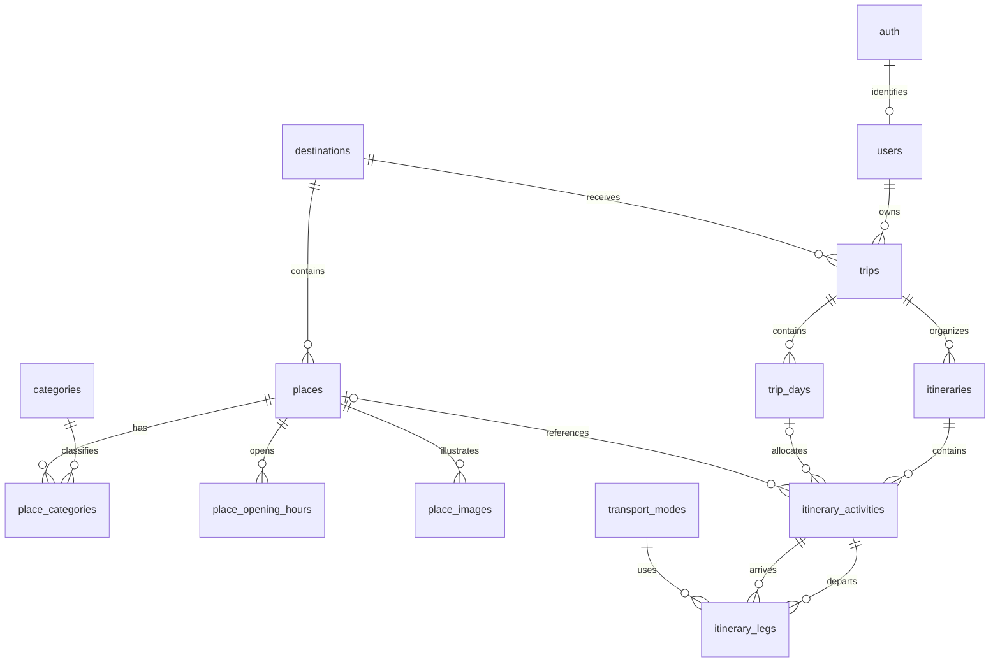

# TripShare database

Modelo PostgreSQL 16.

Esta entrega implementa a persistência e suas garantias estruturais, as entidades JPA `Auth` e `User`,
cadastro de perfil e login autenticados por ID token Firebase. Publicação, geração de roteiros e
fluxos administrativos continuam fora dessa implementação. O fluxo Firebase substitui as regras
anteriores de senha e sessão local dos RF-01–RF-03.

## Executar

Com Docker em execução, entre em `trip.share/`. Opcionalmente copie `.env.example` para `.env` e
ajuste a configuração. Nunca versione credenciais reais.

```bash
# Banco disponível e atualizado, sem executar a aplicação
./scripts/database.sh start

# Verificar histórico e versões pendentes
./scripts/database.sh status

# Reiniciar e verificar migrations novamente
./scripts/database.sh restart

# Aplicar novas versões sem reiniciar PostgreSQL
./scripts/database.sh migrate

# Inserir demonstração explicitamente, somente em desenvolvimento
./scripts/database.sh start --demo

# Aplicação Java local: Compose fornece a conexão; Spring executa Flyway antes do JPA
./mvnw spring-boot:run

# Aplicação completa em containers: PostgreSQL -> migrate -> spring
docker compose --profile app up --build

# Encerrar containers preservando dados
docker compose --profile app down
```

Os comandos do script funcionam a partir de qualquer diretório. `migrate` e `status` pressupõem
que PostgreSQL já esteja disponível. Para `restart`, encerre primeiro a aplicação local para não
executar operações contra um banco em reinicialização. O comando não encerra processos Java externos.

O contrato de atualização automática cobre os comandos do projeto, a execução completa do Compose e
a inicialização do Spring Boot. `docker start`, `docker restart`, o botão do Docker Desktop e
`docker compose up postgres` isoladamente não executam o migrador. Use o script para iniciar só o banco.

### Conexão

| Ambiente | Host | Configuração |
|---|---|---|
| Java local com suporte Compose | Porta publicada em localhost | Descoberta automática pelo Spring |
| Java em container | `postgres:5432` | `SPRING_DATASOURCE_URL/USERNAME/PASSWORD` |
| Migrador em container | `postgres:5432` | `FLYWAY_URL/USER/PASSWORD` |
| Teste de inicialização | H2 em memória | Perfil Spring `test`, Flyway desabilitado |
| Testes de banco | PostgreSQL 16 temporário | Testcontainers, esquemas isolados |

Os padrões `mydatabase` e `postgres/postgres` são exclusivamente de desenvolvimento. Configure
variáveis de ambiente ou `.env`. Alterar essas variáveis não altera usuários/senhas já existentes
em um volume PostgreSQL inicializado: alterações de credenciais existentes exigem operação administrativa.
Não execute o Dockerfile isoladamente esperando que ele forneça banco ou credenciais.
Em produção, use usuários distintos com os privilégios necessários à aplicação e às migrations;
não use a conta administrativa de desenvolvimento nem exponha a porta do banco publicamente.
`SPRING_PORT` permite mudar a porta HTTP publicada. Para executar projetos Compose isolados na mesma
máquina, ajuste também `COMPOSE_PROJECT_NAME`, `POSTGRES_CONTAINER_NAME`, `SPRING_CONTAINER_NAME` e as portas.

## Versionamento e recuperação

Flyway 12.4.0 é gerenciado pelo Spring Boot 4.1.1. O starter e o módulo PostgreSQL habilitam a
integração da aplicação. O estágio Docker `migrate` usa o mesmo projeto Maven e a mesma versão,
sem exigir uma imagem Flyway AMD64 em máquinas ARM64. Os arquivos SQL são montados somente para leitura
nesse serviço, permitindo que `migrate` e `status` enxerguem as versões do checkout atual.
O Maven do migrador opera offline, com dependências previamente resolvidas durante o build.

| Versão | Responsabilidade |
|---|---|
| V1 | Identidade, referências e catálogo |
| V2 | Viagens e planejamento |
| V3 | Comunidade, imagens, notificações e moderação |
| V4 | Integridade entre tabelas, índices, projeções públicas e ranking |
| V5 | Categorias, ritmos e meios de transporte iniciais |
| V6 | Verificação adiável da FK de dias para permitir a cascata completa de exclusão da viagem |
| V7 | Reset autorizado de usuários legados; auth Firebase, users.auth_id obrigatório e remoção da autenticação local |

O histórico fica em `flyway_schema_history`. Cada inicialização valida checksums e aplica apenas
versões pendentes, sob o bloqueio de migração do Flyway. A referência de versão mais recente são
os scripts distribuídos com a aplicação/checkout, sem buscar SQL remoto em tempo de execução.

`clean` e baseline automática estão desabilitados. Migrações fora de ordem, scripts com nome
inválido, versões ausentes/mais recentes no banco e checksums diferentes devem interromper a execução.
Hibernate usa `validate`: não cria nem modifica tabelas e verifica os mapeamentos de `Auth` e `User`.

Para evoluir, adicione `V8__description.sql`, depois V9 etc. Nunca edite migrations já aplicadas.
Inclua a alteração Java correspondente e testes na mesma história de usuário quando houver entidades.
Uma migration PostgreSQL transacional com erro é revertida; investigue antes de repetir. Não use
`repair` para esconder divergências de scripts. Índices concorrentes futuros exigem migration própria
e tratamento específico de transação e bloqueio, não um `CONCURRENTLY` adicionado arbitrariamente.

Se um banco já contiver tabelas sem histórico Flyway, o processo para com erro. Faça um dump,
compare o esquema e planeje uma baseline explícita ou transformação própria; não apague o volume.

### Transição Firebase (V7)

A V7 é destrutiva por decisão explícita para o ambiente de desenvolvimento. `TRUNCATE users CASCADE`
remove usuários antigos e todas as tabelas dependentes, pois não há mapeamento confiável para UIDs
Firebase. Os catálogos e o histórico Flyway permanecem. Faça um `pg_dump` para `.old/` antes da
primeira aplicação; o README contém o comando. A transação da migration reverte a limpeza se falhar.

`auth` possui somente `id uuid` e `uuid varchar(128)`, ambos obrigatórios. `uuid` é o UID opaco e
único do Firebase, não um UUID PostgreSQL. `users.auth_id` é uma FK obrigatória e única: cada perfil
possui uma identidade exclusiva. A busca de login usa esse vínculo, após validar o ID token e
comparar o UID recebido com a identidade verificada. Cadastro cria as duas linhas atomicamente.
Não há senha, sessão ou recuperação de senha local. Consulte os contratos `/auth/register` e
`/auth/login` no README.
Antes de alterações em dados reais, valide restauração do backup e compatibilidade da aplicação.
`down --volumes` apaga dados e não faz parte do fluxo de atualização.

## Seeds

V5 insere dados de referência reais do domínio: sete categorias, três ritmos e quatro transportes.
Novas opções de referência entram em uma nova migration versionada.

`scripts/seeds/demo.sql` contém fixtures explicitamente fictícias, separadas do JAR e das migrations.
O script só as executa com `--demo` e `APP_ENV=development` (padrão local). O seed usa transação,
bloqueio de concorrência, UUIDs estáveis e `ON CONFLICT DO NOTHING`; repetições não duplicam dados
nem sobrescrevem edições. Se um identificador natural estiver ocupado por um registro incompatível,
o seed falha e reverte, em vez de associar registros a uma conta real.

São criadas as contas `demo_alex`, `demo_sam` e `demo_admin`, com emails no domínio reservado
`example.invalid`; a última tem papel ADMIN. As identidades `demo-only-alex`, `demo-only-sam` e
`demo-only-admin` são UIDs fictícios e não habilitam login Firebase. Nunca use essas contas em produção.
Locais de demonstração têm origem `DEMO` e não representam atrações reais, preços ou coordenadas verificados.
O seed não produz uploads fictícios nem solicita serviços externos.

## Convenções e integridade

- UUIDs nativos nas entidades; códigos naturais nas referências; chaves compostas nos vínculos simples.
- `created_at` e `updated_at` são instantes `timestamptz`; triggers mantêm `updated_at`.
  `version` nas raízes prepara o controle otimista futuro; a aplicação deve incrementá-lo com `@Version`.
- Datas pessoais ficam em `trips`. `trip_days.day_number` começa em 1. Horários são locais ao fuso do destino;
  o identificador de fuso IANA deverá ser validado pela aplicação.
- `duration_days` é calculado como término menos início mais um. Não se armazena uma segunda duração editável.
- Email e username têm índices únicos em `lower(...)`; telefone não é identificador único. Login usa
  o UID validado, consultando `auth.uuid` e `users.auth_id`, ambos com índices únicos.
- Firebase é responsável pelas credenciais e tokens. Não persistir senhas, tokens originais ou
  chaves de serviço no banco e não expor esses dados em logs ou projeções públicas.
- Durações/valores desconhecidos são `NULL`, nunca zero inventado. Preço conhecido exige moeda e vice-versa.
  Coordenadas são um par completo com limites geográficos. Horários de locais usam dias ISO 1–7 e suportam
  múltiplos períodos e fechamento no dia seguinte; ausência de linhas significa informação desconhecida.
- Atividades conservam nome, observações e localização independentemente do catálogo. Prefira marcar um local
  com `removed_at` ao retirá-lo do catálogo. Exclusão física desfaz a referência e preserva o snapshot da atividade.
- Um dia não pode pertencer a outra viagem nem exceder o período. Antes de encurtar uma viagem, remova/realoque
  atividades e dias fora do novo intervalo, inclusive dias vazios. Atividades sem dia são itens não alocados.
- A ordem pode ser reorganizada em transação com `SET CONSTRAINTS uq_itinerary_activities_position DEFERRED`.
  Mudanças de planejamento descartam trechos derivados afetados; a aplicação deverá recalculá-los.
- Sobreposições e excesso do intervalo disponível geram avisos na futura aplicação: não há proibição absoluta
  no banco. Estimativas ausentes permanecem pendentes.
- Suspensão de conta bloqueia o login mesmo com token válido.

## Exclusão e privacidade

Viagens e roteiros são privados. Excluir viagem remove seus roteiros e atividades. Excluir um roteiro remove seus dependentes.

A view `public_profiles` não projeta credenciais nem datas privados.

## Testes

```bash
# Sem Docker: inicialização JPA com H2; não valida SQL PostgreSQL.
./mvnw clean verify

# Docker obrigatório: migrations, constraints, seeds, concorrência, privacidade e ranking.
./mvnw verify -Pdatabase-it
```

Testcontainers inicia PostgreSQL temporário e não utiliza o volume do desenvolvimento. Cada cenário
usa um esquema isolado. O perfil falha quando Docker não está acessível. O build Docker mantém os
testes de inicialização e não tenta iniciar containers dentro do estágio de compilação.

## Diagrama de relacionamentos



## Rastreabilidade de requisitos

| RF | Suporte no banco | Responsabilidade da aplicação / Firebase |
|---|---|---|
| 01 | auth, users, unicidade de UID/email/username | Firebase cria a conta; backend cadastra o perfil autenticado |
| 02 | users.auth_id, auth.uuid, users.status | Validar ID token, conferir UID e retornar perfil ativo |
| 03 | users, public_profiles | Edição pelo proprietário e limites de apresentação |
| 04 | trips, destinations, duração calculada | Resolver destino e listar só viagens próprias |
| 05 | Período e cascatas de trips | Confirmar efeitos e realocar antes de encurtar |
| 08 | places, destination_id, place_categories | Busca paginada e fontes externas |
| 09 | Origem, campos opcionais e snapshots | Indicar dados ausentes e locais removidos |
| 10 | Itinerários, dias e atividades | Adicionar ao carrinho e atualizar contador |
| 11 | Atividades sem dia ou sem horário | Gerenciar itens não alocados |
| 12 | Restrições de horário | Validar restrições no item do carrinho |
| 13 | Itinerários AUTOMATIC, dias, atividades, trechos | Geração, horários, pendências e confirmação |
| 14 | Itinerários MANUAL privados | Cadastro manual vinculado à viagem própria |
| 15 | Atividades, ordem, limites de dias e cascatas | Salvar atomicamente e confirmar avisos |
| 16 | Atividades por turno | Timeline e modos de visualização |
| 17 | Coordenadas e posição das atividades | Renderização e fallback do mapa |

O dicionário completo de colunas, tipos, valores padrão e constraints está em [database-dictionary.md](database-dictionary.md).
